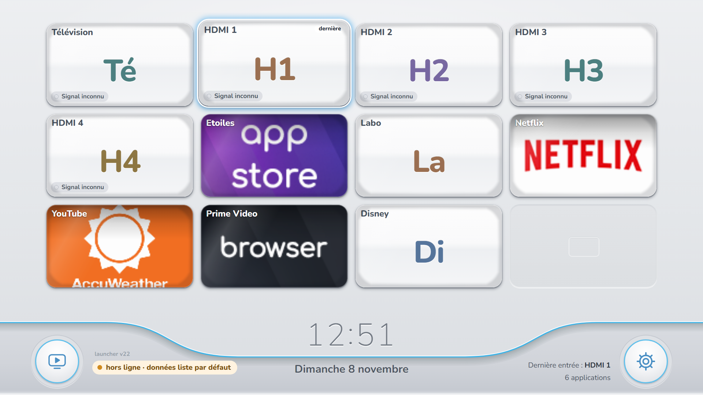
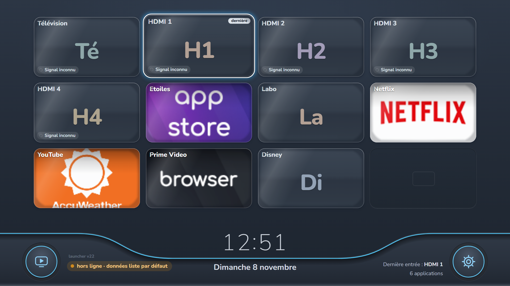
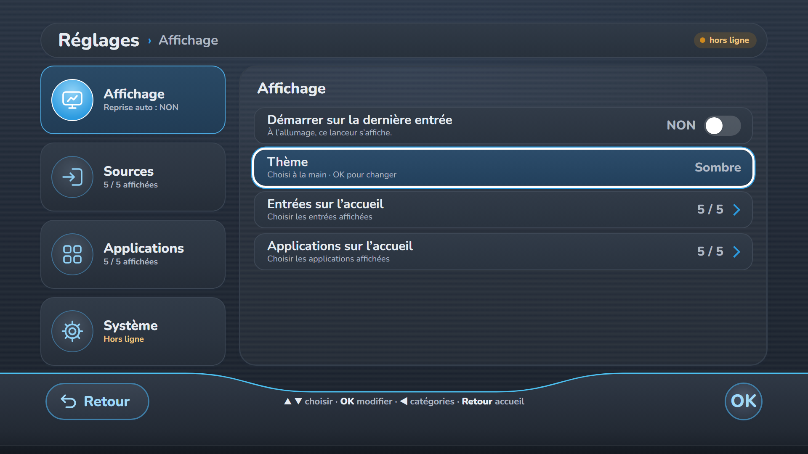
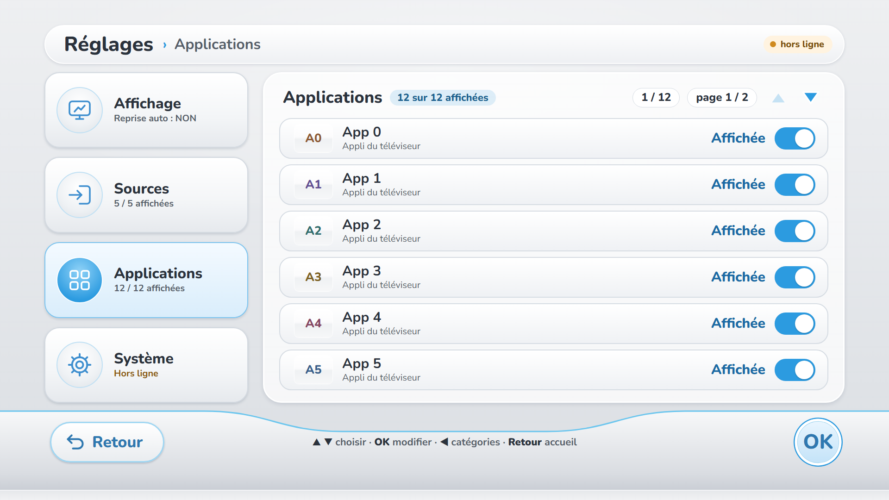

# vidaa-launcher

A custom home screen for a Hisense TV (VIDAA, Chromium 111), built as plain web
pages that a small Node server running on the TV itself serves over
`http://127.0.0.1:8766`. It replaces the stock menu with a channel grid, a
settings page, a lab console and five small games for children aged 4–7.

No build step, no framework, no CDN: every page is a single HTML file with its
CSS, SVG and sound inline. The only network traffic is the loopback WebSocket to
the server that started it.



| | |
|---|---|
|  |  |
| **02** — the same grid after 20:00, or with the theme set to Sombre. | **03** — Réglages › Affichage, theme row focused. |
|  | |
| **04** — the bottom bar of Réglages: Retour, key hints, OK. | |

## Architecture

```
 ┌──────────────────────────────────────────────────────────────┐
 │  the TV's screen — Chromium 111, no chrome, no address bar    │
 │                                                              │
 │  launcher/index.html    home grid, Réglages, offline cache    │
 │  games/*.html           five single-file games                │
 │  lab/index.html         a shell console for the TV            │
 └───────────────┬──────────────────────────────────────────────┘
                 │  HTTP   :8766        pages, icons, /api/*
                 │  WS     /ws          state in, commands out
 ┌───────────────┴──────────────────────────────────────────────┐
 │  host/tvhost.js — Node 20 on the TV (writable partition)      │
 │                                                              │
 │  static files  /var/local/tvhost/www                          │
 │  settings      /var/local/tvhost/settings.json                │
 │  credentials   /var/local/tvhost/keys/tokens.json             │
 └───────────────┬──────────────────────────────────────────────┘
                 │  MQTT 3.1.1 over TLS, port 36669
                 │  the TV's own broker, mobile client certificate
 ┌───────────────┴──────────────────────────────────────────────┐
 │  VIDAA ui_service                                            │
 │  app list · source list · change source · launch app ·       │
 │  TV state · shell (used by the lab page)                     │
 └──────────────────────────────────────────────────────────────┘
```

Two channels, both on loopback:

- **WebSocket `/ws`** — the server pushes a full snapshot
  (`{"t":"state","apps":[…],"sources":[…],"current":"hdmi2","settings":{…}}`);
  the page sends `launch`, `source` and `setting`. The client reconnects every
  3 s and keeps the last snapshot in `localStorage`, so a restart shows the old
  grid at once and swaps in the live one when the socket comes back.
- **HTTP `/api/*`** — `state`, `sources`, `apps`, `switch?id=`, `home` and a
  `POST /api/sh` used by the lab page.

The server also remembers the last input and switches back to it a few seconds
after boot, instead of landing on the stock home screen.

## Running it on a PC

The host script is made for the TV: it reads and writes under
`/var/local/tvhost` and talks to the TV's broker, so it does not run as-is on a
desktop. For layout work, serve the tree statically instead:

```sh
npx http-server . -p 8766 -c-1
# then open http://127.0.0.1:8766/launcher/index.html
```

Any static server works (`python -m http.server 8766`, Live Server, `serve`).
Nothing breaks without the WebSocket: the launcher falls back to the snapshot in
`localStorage`, then to its built-in default list, and shows
*« hors ligne · données … »* in the bottom bar. The theme, the grid, Réglages,
paging and every game behave exactly as on the TV.

`?config=` takes a URL to a JSON file, or the JSON itself, holding `apps` and
`sources`: handy to preview a channel list without touching the TV. The games
(`games/remote.html`, `games/memory.html`, …) and `lab/index.html` open directly
in the browser; the lab page needs the host's `/api/sh` to do anything.

On the TV the same tree lives in `/var/local/tvhost/www` as `launcher/`,
`games/`, `lab/` and `icons/`, and `host/tvhost.js` is started by the phoenix
Node runtime:

```sh
node /var/local/tvhost/tvhost.js       # listens on 0.0.0.0:8766
```

To develop against real TV data from a PC, edit the `BASE` constant (or copy the
tree there) and keep port 8766 free.

## Controls

The TV's remote is read as a keyboard, and two input styles are supported on
every page, at the same time:

| Action | Keys | Pointer mode |
|---|---|---|
| Move | ▲ ▼ ◀ ▶ (D-pad) | move the pointer; focus follows it |
| Activate | OK / Enter | click |
| Back | Back, Escape, Backspace | the **Retour** button, or the house icon in the games |
| Turn a page | P+ / P−, PageUp / PageDown | side arrows, or the wheel |
| Settings | Menu, or the round button at the bottom right | click it |

In the games, the arrows are the only controls a child needs; `keyboard.html`
also takes run/jump letters for a USB keyboard (physical positions, so AZERTY
and QWERTY both work). Mute is **M** or the speaker icon, and it is remembered.

## Design notes

**Wii-inspired channel grid.** The reference is the console channel menu: a pale
silver background with a soft vertical gradient and a faint sheen, the grid
sitting directly on it with no panel behind, and a light metallic strip at the
bottom under a curved cyan line. Each channel carries its own artwork, and the
name is written on the artwork itself rather than in a footer.

**4×3 landscape tiles.** Twelve channels per page, four across and three down,
each tile a landscape 40 × 22.6 rem (400 × 226 design pixels at 1080p) with a
small 2.2 rem gap; pages turn sideways. The
grid is built once per id and then only updated or moved, so a state message
never rebuilds the DOM, and empty cells are reused grey placeholders from a
small pool.

**Glass and CRT.** The artwork fills the whole tile, inside a 2 px white bevel
with ~10 px corners and a light top highlight. Over it sit the inner vignette of
curved glass — dark at the edges, darkest in the corners — and fine scanlines
from a 1×4 px pattern repeated across the art, which gives the cathode-ray feel
without a single blur filter. On focus the tile lifts and scales to 1.03 with a
soft blue glow. Only `transform` and `opacity` animate; there is no
`backdrop-filter`, no `will-change`, one short shadow per element.

**Night theme, automatic.** In `auto` mode the page is dark from 20:00 to 08:00
and light the rest of the day (`NIGHT_FROM = 20`, `NIGHT_TO = 8`); the owner can
also pin Clair or Sombre in Réglages, and the choice is kept in `localStorage`.
The night palette is a deep blue-grey, not black, with dark metal and off-white
text. Only the CSS colour variables change: the layout, the tiles and the
animations are identical.

**Native resolution, no global scale.** Every size is in `rem` and the root font
size follows the viewport, so 1 rem is 10 design pixels at 1920×1080:

```css
html { font-size: min(0.5208333vw, 0.9259259vh); }
```

The same layout is therefore drawn at the panel's own resolution — 720p, 1080p
or 4K — instead of being a 1080p stage scaled up.

**Nunito, embedded.** The variable font (weights 200–1000, Latin subset, woff2,
from Google Fonts v32, SIL OFL 1.1) is inlined as a `data:` URI in
`launcher/index.html`. It costs about 52 KB of base64 and saves a network
request on a device that may have none; the fallback stack stays behind it.
All on-screen text in the games avoids accented characters, because the TV's
fallback font renders them badly.

## Repository layout

```
launcher/     the home screen and Réglages (single file) + its README
games/        remote, keyboard, memory, music, sort (one file each)
host/         tvhost.js, the Node server that runs on the TV
lab/          a shell console page, served at /lab/
screenshots/  1080p captures used above
tools/        the Python/Pillow scripts that draw the icons and tile overlays
```

The five games, all self-contained, 1920×1080 scenes scaled to fit, fixed
timestep at 60 fps, paused when the page is hidden, sound starting on the first
key press:

| File | Game | Played with |
|---|---|---|
| `remote.html` | **Attrape les étoiles** — a robot catches falling stars | D-pad, OK |
| `keyboard.html` | **La course du renard** — a fox runs to the finish arch | arrows, or a USB keyboard |
| `memory.html` | **Trouve les paires** — animal memory, 2 rounds of 3 pairs | D-pad, OK |
| `music.html` | **Les tambours chanteurs** — play a nursery tune on the drums | OK |
| `sort.html` | **Range les formes** — sort shapes into baskets, by colour then shape | ◀ ▶, OK |

`tools/` holds the artwork generators: `make_scenes.py` (illustrated channel
scenes), `make_source_icons.py` (TV and HDMI artwork), `make_frame.py` (the
9-slice glass screen, scanlines and bevel) and `make_app_icon.py` (the app's own
icon). Each writes to the `OUT` path at the top of the file — point it at your
own `www/icons` folder before running them.

## License

MIT — see [LICENSE](LICENSE).
